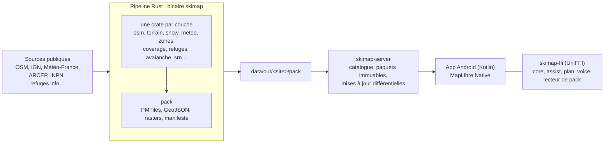

# Traces Blanches

Traces Blanches (nom de code et nom des binaires : `skimap`) est une carte et un assistant de ski de fond et de ski de randonnée nordique (SRN) pour Android, utilisables hors ligne. Un pipeline Rust construit, pour chaque site de France, un pack hors ligne : fonds de carte, pistes, relief et pentes, exposition aux avalanches (modèle), enneigement estimé, refuges, zones réglementées, couverture mobile, graphe de routage. L'app lit ces packs avec le même noyau Rust (routage, temps estimé, demi-tour avant la nuit, hors piste, plan de journée), compilé pour le téléphone.

Le registre compte 272 sites, dont 268 construits par `build-all` (domaines nordiques du recensement, zones et traversées SRN ; `skimap sites`), tous par le même code : ce qui est propre à un site vient d'une table de données, jamais du code (`crates/common/tests/no_site_names.rs`). Deux sites servent de jeux de test, appelés « jeu de test alpin » et « jeu de test jurassien » ([définition](docs/architecture/donnees.md#jeux-de-test)) ; les mesures de ce dépôt valent pour ces deux sites, pas pour toute la France.

Statut : en développement. Ce dépôt ne publie encore ni version ni APK.

## Sommaire

1. [Démarrage](#démarrage) : construire un pack et l'afficher
2. [Architecture](#architecture)
3. [Preuves chiffrées](docs/preuves.md) : tests, couverture, mutation, temps de construction
4. [Sources et licences des données](#sources-et-licences-des-données)
5. [Licence](#licence)
6. [Contribuer](CONTRIBUTING.md), [guide des données](docs/guide-donnees.md), [code de conduite](CODE_OF_CONDUCT.md)
7. [Signaler une faille](SECURITY.md)

## Démarrage

Prérequis : Linux, `rustup` et un compilateur C (`cc`, pour SQLite embarqué). La version de Rust est figée par `rust-toolchain.toml` (1.99.1), installée au premier appel de `cargo`. Aucune clé d'API n'est nécessaire : sans `METEOFRANCE_API_KEY`, le BERA vient de l'archive publique de Météo-France.

```sh
cargo build --release --locked -p skimap-cli          # binaire target/release/skimap
target/release/skimap sites | head                    # identifiants des sites (registre)
target/release/skimap build-all <site>                # télécharge les sources, construit les couches et le pack
```

Les données vont dans `./data` (ou `$SKIMAP_DATA_DIR`) : `data/cache/<source>/` pour les téléchargements, `data/out/<site>/<couche>/` pour les couches, `data/out/<site>/pack/` pour le pack. Sans le registre complet (`data/out/france/sites/sites.json`, écrit par `skimap domaines`), seuls les deux jeux de test sont connus. Le premier `build-all` d'un site télécharge ses sources (extrait OSM, dalles LiDAR HD, tuiles du Plan IGN, simulation nivologique…) ; les suivants relisent le cache. La durée d'un premier `build-all` sur cache vide n'est pas mesurée ici.

Mesuré le 21/11/2026 sur le jeu de test jurassien, cache rempli, sans `SKIMAP_PERSONAL_SOURCES`, poste partagé avec d'autres compilations (charge moyenne 90 sur 20 cœurs) : `build-all` sort avec le code 0 en 272,6 s, dont 91,3 s pour `domaines` (relecture du recensement) et 79,7 s pour `meteo` (téléchargement AROME) ; `status-poll` ignorée (source à usage personnel), `avalanche-historic` et `plan` sans objet, toutes les autres étapes faites ; pack de 33,47 Mo, 37 couches, relu par le lecteur du téléphone (« relecture : OK »). La liste des étapes et leurs dépendances : [compiler.md](docs/architecture/compiler.md#ligne-de-commande).

Afficher le pack dans le visualiseur (MapLibre GL JS, page statique) :

```sh
target/release/skimap serve .                         # depuis la racine du dépôt, data/ à côté
# puis dans un navigateur :
# http://127.0.0.1:8765/tools/viewer/index.html?pack=../../data/out/<site>/pack/
```

Le serveur gère les requêtes partielles qu'exigent les PMTiles ([tools/viewer/README.md](tools/viewer/README.md)). L'app Android se construit sous `android/` ([android/README.md](android/README.md)).

Vérifications (les mêmes que la CI locale) :

```sh
cargo fmt --all --check
cargo clippy --workspace --all-targets --locked -- -D warnings
cargo test --workspace
cargo deny --locked check
cargo deny --locked --manifest-path crates/ffi/Cargo.toml --config deny-phone.toml check bans licenses
```

## Architecture



- Workspace cargo de 27 crates (`crates/`), édition 2024, tout bloquant (aucune API `async`) ; carte des crates et règles : [docs/architecture.md](docs/architecture.md), [crates.md](docs/architecture/crates.md).
- Les crates du téléphone (`core`, `assist`, `plan`, `voice`, lecteur de `pack`, `ffi`) n'embarquent aucune pile HTTP ; le téléphone ne contacte jamais les sources, seulement le serveur de packs, puis travaille hors ligne.
- Python n'est jamais dans le chemin de calcul : il sert d'oracle de référence (par exemple AutoATES pour l'exposition aux avalanches) ou d'outil.

## Preuves chiffrées

Tests, couverture des lignes par crate, score de mutation, temps de construction d'un site, avec la commande et la date de chaque mesure : [docs/preuves.md](docs/preuves.md).

| Mesure (21/11/2026 sauf mention) | Valeur |
|---|---|
| Tests (`cargo llvm-cov --workspace`) | 1 177 passés, 0 en échec, 71 ignorés |
| Couverture des lignes, workspace | 79,3 % (84 029 / 106 007) ; `core` 96,6 %, `assist` 96,9 %, `plan` 94,9 %, `pack` 81,1 %, `ffi` 73,7 %, `cli` 48,2 % |
| Score de mutation (Q4, #104) | `core` 82,9 %, `voice` 79,3 %, `assist` 49,8 % |

## Sources et licences des données

Un pack est une collection de couches indépendantes ; chacune garde la licence de sa source, écrite dans son `<couche>.meta.json` et dans `attributions[]` du manifeste du pack :

- ODbL 1.0 : couches tirées d'OpenStreetMap (pistes, domaines, graphe de routage, fond OSM) ; l'extrait OSM et le code qui le transforme sont publiés ;
- CC BY-SA : refuges (refuges.info, Camptocamp), dans une couche à part, jamais mêlée à une couche OSM ;
- Licence Ouverte 2.0 : Plan IGN, relief LiDAR HD, données Météo-France, ARCEP, INPN, GPU, et les couches calculées par skimap à partir d'elles (pentes, exposition aux avalanches, enneigement estimé, zones sans réseau), avec la mention des sources d'origine ;
- sources à usage personnel (état des pistes publié sans licence, API gratuite d'Open-Meteo, CLPA et EPA d'INRAE, pages des émetteurs de titres) : lues seulement avec `SKIMAP_PERSONAL_SOURCES=1` et jamais dans un pack publié (`skimap_common::licence`).

Sources, textes lus et décisions : [docs/licences-donnees.md](docs/licences-donnees.md). La licence du code ne s'applique pas aux données.

## Licence

Le code de skimap est sous licence GPL-3.0-or-later ([LICENSE](LICENSE)), avec une permission additionnelle (section 7 de la GPLv3) qui autorise la diffusion par les boutiques d'applications ([LICENSE-EXCEPTION](LICENSE-EXCEPTION)). Exception : `crates/avalanche`, portage Rust de com4FlowPy (AvaFrame), reste sous EUPL-1.2 ([LICENSES/EUPL-1.2.txt](LICENSES/EUPL-1.2.txt)) ; seul le pipeline la lie (`skimap-cli`, et `skimap-srndiff` avec sa fonction `pipeline`), jamais l'app, ce que vérifie `deny-phone.toml`. Licences des composants tiers : [THIRD-PARTY.md](THIRD-PARTY.md), généré par `docs/licences/third-party.sh`. Choix et raisons : [docs/licences/f2-licence-code.md](docs/licences/f2-licence-code.md).

## Contribuer

Les contributions sont bienvenues, y compris celles écrites avec un outil d'IA, relues par un humain et accompagnées de leurs preuves : [CONTRIBUTING.md](CONTRIBUTING.md). Une faille de sécurité se signale en privé : [SECURITY.md](SECURITY.md).

La CI tourne sur le poste de chaque contributeur, pas sur GitHub Actions : `scripts/ci` (tout), `scripts/ci --quick` (fmt, clippy, tests ; le hook pre-push, à activer par `git config core.hooksPath .githooks`). Détails : [docs/ci-locale.md](docs/ci-locale.md).
